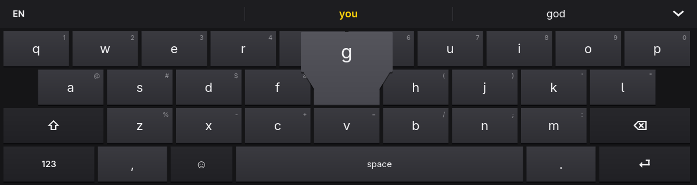

# KeyboardPOP for Omarchy



A touch keyboard for Omarchy tablets like the Surface Go, ported from the
[PressPop / SafePop Android keyboard](https://github.com/wilsonsamiano/presspop-keyboard).
Press a key and an enlarged bubble pops up above it; glide across the
letters to swipe-type. It follows the Omarchy theme's accent and window
rounding live, and its few words follow the language picked under
Setup > Language.

## What it does

- **Key popups** on every key, iPhone style. Slide and the bubble follows.
- **Swipe typing.** Glide across the letters and lift; the shape is matched
  against the dictionary (your own words first), with a trail in the accent
  color.
- **Suggestions.** The strip shows completions while you type and the
  likely next word between words (from your own sentences, then KeyboardPOP's
  phrase model). On Space, a word that isn't in the dictionary gets its
  closest word offered in the middle slot: tap it to fix the word, tap the
  word as you typed it to keep it.
- **Always fixed:** `i` → `I`, `dont` → `don't`, `im` → `I'm`, rank
  abbreviations (`sgt` → `SGT`) and brand names (`iphone` → `iPhone`).
  Delete right after a contraction puts the word back as you typed it.
- **Auto-capitalization** at the start of a field and after `. ? !`.
- **Personal dictionary.** A word you keep typing (77 times, or sooner when
  you turn down its corrections) is learned and stops being corrected.
- **Accents.** Hold a letter for its accents, slide to one, lift.
- **Symbols without switching.** Pull a letter key down for the symbol in
  its corner (`q` → `1`, `a` → `@`, …).
- **Space-bar cursor.** Hold Space, then slide to move the cursor (up and
  down moves lines).
- **Double-tap Shift** for caps lock. **Double-tap Space** for `. `.
- **Delete** repeats while held; swipe left off it to delete a word.
- **Pages:** letters, numbers, symbols, 30 emoji, and a phone-style number
  pad.
- **Languages:** tap **EN** in the strip to cycle English, Tagalog, and
  Spanish dictionaries.
- **Two-thumb typing:** a second finger landing finishes the first finger's
  tap instead of being ignored.

Everything runs on this machine; nothing is sent anywhere.

## Showing and hiding

Tap **KeyboardPOP** in the app launcher (`Super + Space`) to show the keyboard,
and again to hide it; the chevron at the right of the strip hides it too.
Windows make room above it instead of being covered.

To open and close it with a key, bind `keyboardpop toggle` in
`~/.config/hypr/bindings.lua`:

```lua
o.bind("SUPER + CTRL + Y", "Touch keyboard", "keyboardpop toggle")
```

### Opening by itself on text fields

KeyboardPOP can open whenever a text field is focused, and then it also knows
the text around the cursor and turns off suggestions in password fields.
That needs KeyboardPOP to be the seat's **input method**, and Wayland allows
only one. Omarchy runs **fcitx5** as the input method (for compose keys,
emoji picking, and Asian scripts), so while fcitx5 is running KeyboardPOP types
as a virtual keyboard instead: it works in every app, but you show and hide
it yourself. The ⓘ in the strip says which way it's typing.

Without fcitx5, start KeyboardPOP with the session, hidden, in
`~/.config/hypr/autostart.lua`, and it will come and go with text fields:

```lua
o.launch_on_start("keyboardpop hide")
```

It only pops up when you tap a field with your finger; clicking one with
the mouse or tabbing to it leaves it hidden. To tell the two apart KeyboardPOP
reads the touchscreen, which the package's udev rule
(`/usr/lib/udev/rules.d/70-keyboardpop-touchscreen.rules`) lets the logged-in
user do for touchscreens only. Without that access it pops up on every
focused field.

## Commands

| Command | |
|---|---|
| `keyboardpop` / `keyboardpop toggle` | Show the keyboard, or hide it if it's showing |
| `keyboardpop show` / `keyboardpop hide` | Show or hide it (`hide` starts it hidden if it isn't running) |
| `keyboardpop quit` | Stop it |
| `keyboardpop import <file>` | Merge a personal-dictionary backup from the Android app |
| `keyboardpop export <file>` | Save the personal dictionary as a backup |

The personal dictionary lives in `~/.local/share/keyboardpop/personal.json`,
in the same format the Android app exports, so the two can share words.

The keyboard never takes keyboard focus away from the app you're typing in,
so it has no keyboard shortcuts of its own (no `?` or `Q`): everything is a
touch target.

## Build

```sh
bin/build      # qmake6 + make into build/keyboardpop
bin/test       # the Qt Test suite, offscreen
bin/install    # makepkg -fsi, so it shows up in the app launcher
```

Needs `qt6-base`, `qt6-declarative`, `qt6-wayland`, `layer-shell-qt`,
`wayland`, and `libxkbcommon`, all part of Omarchy.

## Not yet

From the Android app: clipboard history, one-handed mode, the number-row
toggle, custom language packs, voice typing, and GIF search.

## License

MIT. See [LICENSE](LICENSE).
